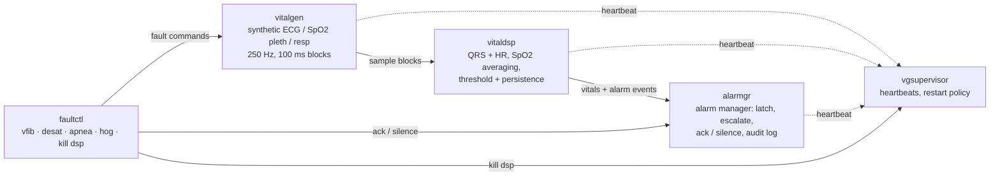

# VitalGuard

**A patient-monitor alarm core for QNX 8.0 that treats alarm latency and
alarm correctness as real-time properties — and proves it with measurements.**

VitalGuard is a small, multi-process vital-signs monitor built for the
[QNX Global Hackathon](https://qnx.devpost.com/) (category: **Robotics &
Medical**). It generates synthetic ECG / SpO₂ / respiration signals,
extracts vital signs with a DSP pipeline, and runs every alarm through an
IEC 60601-1-8-inspired alarm manager — persistence delays, latching,
escalation, silence/acknowledge — under a supervisor that keeps the
pipeline alive when individual processes die.

The design point is the one real monitors live or die by: **a lethal
rhythm must annunciate within a bounded, measured time — even while the
CPU is saturated and even after the DSP process is killed and restarted —
while nuisance conditions must *not* fire early.** Alarm fatigue kills
patients; so does a late VFib alarm. VitalGuard is built, and measured,
against both failure modes.

> **Safety note:** VitalGuard is a research/education prototype running on
> synthetic signals. It is not a medical device and must never be used
> for patient care.

## Architecture

Four processes, one job each, connected by a thin message transport with
one interface and two backends: Unix-domain sockets on the Linux host
build, **native QNX message passing** (`name_attach` rendezvous,
`MsgSend`/`MsgReceive`/`MsgReply` with priority inheritance) on target —
see `src/ipc/ipc.h`.



Why separate processes? Because on QNX each one gets its own fixed
priority and its own failure domain: the alarm manager runs hot, the
signal generator can stumble without taking detection down, and the
supervisor restarts a dead DSP while the alarm path stays live. (The
supervision *policy* — 3 s heartbeat timeout, restart budget 10 per 60 s,
0.5 s → 4 s backoff, dependency-ordered startup — is implemented by
`vgsupervisor` today; its mapping onto QPLMS/`slm` mechanics is
documented in `docs/design.md`.) The fault-injection CLI exists so the
demo — and the tests — can break things on purpose and watch the system
behave.

## Design highlights

- **Native QNX message passing, used the way QNX intends.** One channel
  per endpoint via `name_attach()`; a HELLO rendezvous keyed by the
  kernel-supplied connection id (scoid); the receiver inherits the
  sender's priority while handling a message, which bounds priority
  inversion on the alarm path. The receive → queue → reply discipline
  bounds each connection to two messages in flight (backpressure, not
  unbounded queues), and peer death arrives as a disconnect pulse with
  exactly the semantics the POSIX backend gives a socket hangup — so one
  source tree serves both backends.
- **Alarm management modelled on IEC 60601-1-8.** Per-condition
  persistence delays before annunciation (the strongest alarm-fatigue
  defence), HIGH-priority latching (a self-terminating VFib still
  happened, and someone must see it), escalation of unacknowledged
  alarms after 60 s, silence as a 120 s audio pause with
  re-annunciation, and an append-only audit log of every transition.
- **Supervision that survives its own demo.** The image autostarts the
  pipeline at boot; kill the DSP mid-stream and the supervisor restarts
  it (measured: streaming resumes 0.78–2.11 s after the kill).
- **A warm-up guard against restart transients.** A DSP that rejoins a
  running stream with zeroed detector state can hallucinate a VFib for
  a few seconds — ours did, and the fix is a 5 s warm-up window plus a
  detector reset on any stream discontinuity, locked in by regression
  tests on host and target.
- **Dual-path heart-rate detection.** HR alarms are raw on the 8-beat
  median *or* the latest RR interval, so the persistence clock starts
  when the condition starts — this closed a real budget miss
  (bradycardia at 14.1 s vs an 8 s budget) without weakening the
  false-alarm contract.
- **Deterministic by construction.** Every sample block carries a
  signal-clock stamp from the generator, so DSP and alarm behaviour is
  reproducible offline, bit-for-bit — the host unit tests exercise the
  same timing the target measurements later confirm.
- **Measured with the instrumented kernel.** `tracelogger` traces of
  the alarm path show the DSP → alarm-manager `MsgSend` round trip
  completing in **94 µs under full CPU load** — IPC is ~0.005 % of
  end-to-end latency; the budget is spent in the designed detection and
  persistence windows, where a monitor should spend it.

## Measured on target

Alarm latency (signal-clock onset → annunciation), measured in the QNX
8.0 guest over 71 scripted fault injections plus supervisor-restart
runs. Full method, distributions and raw-data inventory:
[docs/latency-report.md](docs/latency-report.md).

> **Emulation caveat:** the guest runs under QEMU **TCG software
> emulation** (this VM has no KVM). These are emulated distributions
> demonstrating budget compliance and timing behaviour — **not hardware
> measurements**, and they are never quoted as such.

| Condition | n | median | max | Budget | Verdict |
|---|---|---|---|---|---|
| VFib | 10 | 1.66 s | 2.30 s | ≤ 4 s | ✅ |
| VFib, CPU saturated (2× hog) | 10 | 2.01 s | 2.33 s | ≤ 4 s | ✅ holds under load |
| Asystole | 10 | 3.83 s | 4.21 s | — (3.5 s persistence by construction) | ✅ |
| Tachycardia (HR_HIGH) | 3 | 6.17 s | 6.20 s | ≤ 8 s | ✅ |
| Bradycardia (HR_LOW) | 5 | 7.27 s | 7.69 s | ≤ 8 s | ✅ (was 14.1 s — see report §7) |
| SpO₂ drop | 10 | 17.18 s | 17.21 s | ≤ 24 s | ✅ |
| Apnea | 10 | 8.92 s | 11.39 s | ≤ 12 s | ✅ |

Supervisor restart (kill DSP → streaming resumed): **0.78–2.11 s** (n=5;
the spread is the designed restart backoff, not degradation).

## Build and run

### Host (Linux) — no QNX licence needed

```sh
make            # gcc, C11, -Wall -Wextra, zero warnings
make test       # unit + integration suite (see tests/)
tools/demo.sh   # guided ~75 s demo: desat → VFib → CPU hog → kill DSP
```

`tools/demo.sh` leaves the system running at the end; press Ctrl-C to
stop it (the supervisor takes the children down).

### QNX target

```sh
source ~/workspace/qnx/sdp/qnx800/qnxsdp-env.sh   # your SDP 8.0 path
make -f Makefile.qnx                              # -> bin-qnx/ (native backend)
make                                              # host build stays green
```

The bootable QEMU image is built with `mkqnximage` from the SDP
baseline (the QSTI package route is not required); the exact image
recipe, the VitalGuard `system_files`/`post_start` snippets and the
guest-boot command live in [qemu/README.md](qemu/README.md) and
[qemu/run-qemu.sh](qemu/run-qemu.sh). The image autostarts the whole
pipeline at boot — no login, no manual steps. Inside the guest,
everything is driven through the same CLI as on the host:

```sh
faultctl vfib 10        # inject ventricular fibrillation for 10 s
faultctl desat 84 30    # SpO2 desaturation to 84 % for 30 s
faultctl apnea 25       # apnea for 25 s
faultctl kill dsp       # kill the DSP; watch the supervisor restart it
faultctl ack <id>       # acknowledge a latched HIGH alarm
cat /tmp/vitalguard/alarm_events.log    # the audit log
cat /tmp/vitalguard/supervisor.status   # who is running, restart counts
```

The [demo video](demo/vitalguard-demo.mp4) (2 min 11 s) is a single
scripted session on this image: clean boot → autostart → VFib injection
→ latched HIGH alarm → acknowledge → `kill dsp` → supervised restart →
streaming resumes. The raw serial-console log and the rendering script
are in [demo/](demo/) next to it.

## Repository layout

```
src/common/     wire protocol (vg.h), monotonic time, logging,
                heartbeats, vg_path.c self-location
src/signals/    synthetic ECG (7 rhythms incl. VFib/asystole/AFib),
                SpO2 (desaturation events), respiration (apnea events);
                deterministic xorshift PRNG — demos are reproducible
src/dsp/        Pan–Tompkins-lite QRS, median + interval HR, SpO2 8 s
                average, respiration (hysteresis detector),
                per-condition persistence, warm-up guard
src/alarm/      alarm manager: priorities, latching, escalation,
                ack/silence, append-only audit log
src/ipc/        one transport interface, two backends:
                ipc_posix.c (host) and ipc_qnx.c (native QNX message
                passing) — exactly one is linked per build
src/supervisor/ restart policy (heartbeat timeout, restart budget,
                exponential backoff) — mechanism lives in the apps
src/apps/       vitalgen, vitaldsp, alarmgr, vgsupervisor processes
src/faults/     faultctl CLI + vghog CPU-hog helper
tests/          test_dsp, test_alarm, test_ipc, test_supervisor.sh
docs/design.md  alarm philosophy, latency budget, QNX mechanism mapping
docs/latency-report.md  on-target measurements: method + distributions
demo/           demo video, raw session log, session + render scripts
qemu/           QNX QEMU target: build/run notes, native-IPC spike
STATUS.md       project log: what is verified, what is still open
```

## Known limitations, stated plainly

- All on-target numbers are QEMU TCG-emulated distributions (see the
  caveat above). Real-hardware numbers are future work.
- Supervision on target is the hand-written `vgsupervisor` (policy
  proven on host and target). The QPLMS/`slm` mechanics swap is
  designed and documented, not yet landed; the image runs with
  `OPT_SLM=no`.
- The dev image's `sshd` segfaults at startup; the serial console is
  the access path. Not on the demo's critical path.
- Signals are synthetic and deliberately simple (see
  `docs/design.md` §4) — enough to exercise the detectors honestly,
  not a physiological model.

## Licence

Apache-2.0 — see [LICENSE](LICENSE). Copyright 2026 Jion White.
