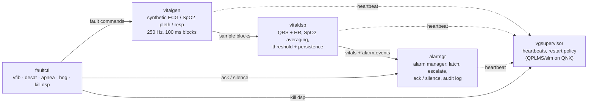

# VitalGuard

**A patient-monitor alarm core for QNX 8.0 that treats alarm latency and
alarm correctness as real-time properties — and proves it with measurements.**

VitalGuard is a small, multi-process vital-signs monitor built for the
[QNX Global Hackathon](https://qnx.devpost.com/) (category: Robotics &
Medical). It generates synthetic ECG / SpO₂ / respiration signals, extracts
vital signs with a DSP pipeline, and runs every alarm through an
IEC 60601-1-8-inspired alarm manager — persistence delays, latching,
escalation, silence/acknowledge — under a supervisor that keeps the
pipeline alive when individual processes die.

The design point is the one real monitors live or die by: **a lethal
rhythm must annunciate within a bounded, measured time — even while the
CPU is being hogged and even after the DSP process is killed and
restarted — while nuisance conditions must *not* fire early.** Alarm
fatigue kills patients; so does a late VFib alarm. VitalGuard is built,
and tested, against both failure modes.

> **Safety note:** VitalGuard is a research/education prototype running on
> synthetic signals. It is not a medical device and must never be used
> for patient care.

## Architecture

Four processes, one job each, connected by a thin message transport
(Unix-domain sockets on the Linux host build; QNX native message passing
with priority inheritance on target — same interface, see
`src/ipc/ipc.h`):



Why separate processes? Because on QNX each one gets its own fixed
priority and its own failure domain: the alarm manager runs hot, the
signal generator can stumble without taking detection down, and the
supervisor (QPLMS/`slm` on target) restarts a dead DSP while the alarm
path stays live. The fault-injection CLI exists so the demo — and the
tests — can break things on purpose and watch the system behave.

## What works today (host build, Linux)

The whole system builds and runs on a Linux host, and the test suite
proves the behaviours the demo is built on:

| Behaviour | Evidence |
|---|---|
| HR extraction accuracy | 59.6 / 72.3 / 88.8 / 118.1 bpm measured for 60 / 72 / 90 / 120 bpm targets (±3 bpm required) |
| VFib alarm latency | raised **1.5 s** after onset (budget ≤ 4 s) |
| SpO₂ persistence | desaturation to 84 % raised SPO2_LOW after **16.9 s** — never before the 10 s persistence delay, inside the 24 s budget |
| Asystole detection | raised **3.8 s** after flat-line onset; flat line is *not* misclassified as VFib |
| Alarm state machine | escalation at the configured delay, HIGH alarms latch until acknowledged, silence expires and re-annunciates, MEDIUM escalates to HIGH, audit log written for every transition |
| Transport cost | IPC round trip **0.02 ms** average (200 framed ping-pongs) |
| Supervision | `faultctl kill dsp` → supervisor restarts vitaldsp (new pid, restart counter increments), pipeline recovers, a subsequent VFib still reaches the alarm audit log |

Run it yourself:

```sh
make            # gcc, C11, -Wall -Wextra, zero warnings
make test       # unit + integration suite (see tests/)
tools/demo.sh   # guided ~75 s demo: desat → VFib → CPU hog → kill DSP
```

## Repository layout

```
src/common/     wire protocol (vg.h), monotonic time, logging, heartbeats
src/signals/    synthetic ECG (7 rhythms incl. VFib/asystole/AFib),
                SpO2 (desaturation events), respiration (apnea events);
                deterministic xorshift PRNG — demos are reproducible
src/dsp/        Pan–Tompkins-lite QRS, HR, SpO2 8 s average, respiration
                (hysteresis detector), per-condition persistence timing
src/alarm/      alarm manager: priorities, latching, escalation,
                ack/silence, append-only audit log
src/ipc/        one transport interface, two backends:
                ipc_posix.c (host) and ipc_qnx.c (QNX port target,
                __QNX__-guarded, clearly marked)
src/supervisor/ restart policy (heartbeat timeout, restart budget,
                exponential backoff) — mechanism lives in the apps
src/apps/       vitalgen, vitaldsp, alarmgr, vgsupervisor processes
src/faults/     faultctl CLI + vghog CPU-hog helper
tests/          test_dsp, test_alarm, test_ipc, test_supervisor.sh
docs/design.md  alarm philosophy, latency budget, QNX mechanism mapping
qemu/           QNX QEMU target notes + launcher (in progress, needs SDP)
```

## QNX target status

The code is written against a POSIX subset that maps directly onto QNX
Neutrino APIs, and the QNX IPC backend (`src/ipc/ipc_qnx.c`) is in place
as a marked port skeleton (ChannelCreate / ConnectAttach / MsgSend /
MsgReceive / name_attach). The remaining target work — SDP 8.0 build,
QPLMS supervision configuration, priority assignment, and `tracelogger`
latency distributions on the QEMU Quick Start Target Image — is gated on
the free QNX Everywhere licence and is tracked in [STATUS.md](STATUS.md)
and [qemu/README.md](qemu/README.md). Design rationale, the alarm
philosophy and the latency budget live in [docs/design.md](docs/design.md).

## Licence

Apache-2.0 — see [LICENSE](LICENSE). Copyright 2026 Jion White.
